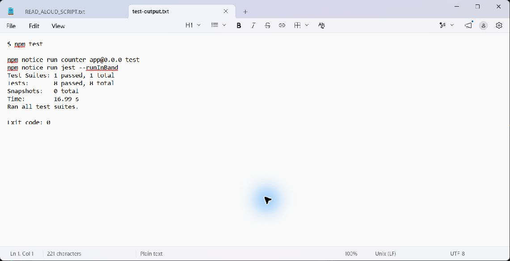
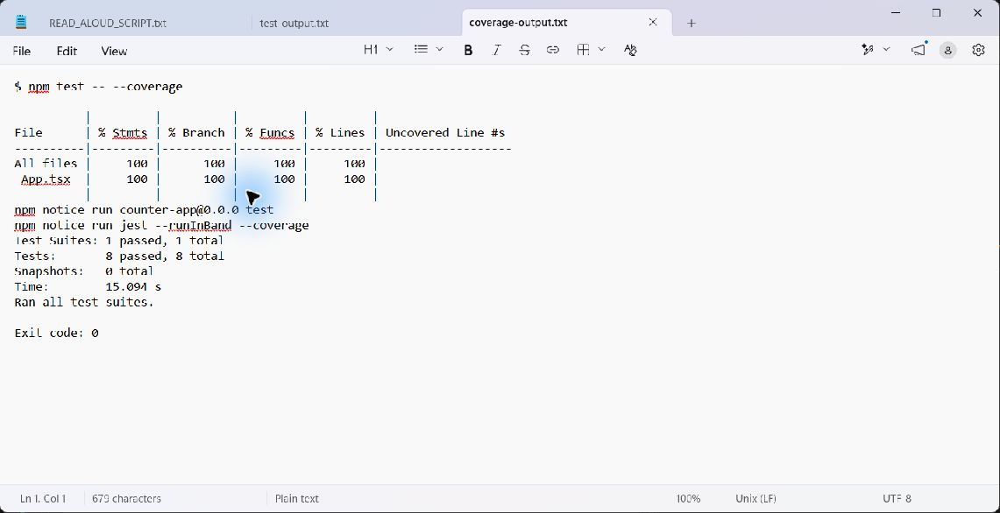

# Lab: Exploratory and White Box Testing

## Testing method

This is an AI-assisted lab record. `App.tsx` was opened during initial inspection,
before exploration. The user subsequently requested completion without Chrome.
Headless Firefox could not launch and the in-app preview timed out, so the
observations below were made by mounting the real component in **jsdom** and
activating its DOM buttons. They are actual execution results, not predictions
presented as results. This does not satisfy the original instruction to perform
a blind manual browser exploration before viewing the source.

Tests and coverage were executed locally. The production component is unchanged.

## 1. Exploratory testing

**Charter:** Investigate how Increment, Decrement, and Reset affect the displayed
count. Try repeated actions, negative values, resetting from different values,
and continued use after reset. Compare each observed result with its expected
value. Browser layout and real keyboard behavior are outside this DOM session.

Rows were executed in order. Every number represents the `Count: n` heading.

| Action or combination | Expected result | Actual result | Pass/Fail |
| --- | --- | --- | --- |
| Mount the component | Starts at 0 | 0 | Pass |
| Increment once from 0 | 1 | 1 | Pass |
| Increment twice more from 1 | 2, then 3 | 2 → 3 | Pass |
| Reset from 3 | 0 | 0 | Pass |
| Decrement three times from 0 | -1, -2, -3 | -1 → -2 → -3 | Pass |
| Reset from -3 | 0 | 0 | Pass |
| Reset again at 0 | Remains 0 | 0 | Pass |
| Increment, Increment, Decrement, Reset, Increment | 1, 2, 1, 0, 1 | 1 → 2 → 1 → 0 → 1 | Pass |

No mismatch occurred. Negative counts were accepted; no non-negative requirement
was provided. Repeated Reset kept zero, and the next Increment worked. The full
observations are saved in [exploration.json](evidence/exploration.json).

## 2. Source-code examination

`const [count, setCount] = useState(0)` initializes `count` to **0**.

| Statement | User action | Effect |
| --- | --- | --- |
| `setCount(count + 1)` | Activate Increment | Schedules the current rendered count plus one |
| `setCount(count - 1)` | Activate Decrement | Schedules the current rendered count minus one |
| `setCount(0)` | Activate Reset | Sets the next count to zero |

React re-renders the heading after each state update. The component has no `if`,
`switch`, conditional expression, or loop. Branch coverage has no authored
decisions to exercise, and loop coverage does not apply. Repeated clicks execute
event handlers repeatedly; they are not a loop in `App.tsx`. Loops in test
utilities or React internals are outside this component's coverage scope.

## 3–6. Automated test design

The eight tests in [App.test.tsx](src/App.test.tsx) use a `describe` block,
`render`, `screen`, awaited `userEvent` interactions, and Jest assertions extended
with jest-dom matchers. Each test gets a fresh render, and React Testing Library
cleans up between tests. State setters are not mocked.

1. Verify `Count: 0` and all three visible buttons.
2. Increment from 0 to 1.
3. Decrement from 0 to -1.
4. Increment to 2, verify the nonzero value, then Reset to 0.
5. Decrement to -2, verify the nonzero value, then Reset to 0.
6. Reset twice while already at 0.
7. Check each action in the sequence 1 → 2 → 3 → 2 → 0 → -1 → 0.
8. Simulate Tab navigation, Enter, and Space; check focus and counts 2 → 1 → 0.

The positive and negative reset tests verify a real state change, rather than
only checking that zero remains displayed. Heading assertions match the whole
text, so `Count: 10` cannot accidentally satisfy an expectation for `Count: 1`.
The keyboard test uses DOM simulation; it does not establish real-browser
accessibility or rendering correctness.

## 7. Test execution

`npm test` completed successfully: **1 suite passed; 8 tests passed; 0 failed**.
Exact output is saved in [test-output.txt](evidence/test-output.txt).
`npm run build` and `npm run lint` also succeeded. Exit codes and execution
metadata are saved in [verification.json](evidence/verification.json).

The screenshot below shows the saved, unedited command output in Notepad. It is
a screenshot of the recorded output, not a live terminal window.

## 8. Coverage review

Command: `npm test -- --coverage`.

| Coverage type for App.tsx | Percentage | Covered / total |
| --- | ---: | ---: |
| Statements | 100% | 5 / 5 |
| Branches | 100% | 0 / 0 |
| Functions | 100% | 4 / 4 |
| Lines | 100% | 5 / 5 |

Tests execute component initialization and rendering, plus all three callbacks.
The four covered functions are `App` and those callbacks. No instrumented
statements or executable lines in `App.tsx` remain uncovered. Imports, braces,
and individual JSX markup lines are not necessarily separate coverage counters.

The branch percentage is a reporting convention for **zero branches**, not
evidence that conditional paths were tested. See the saved
[HTML report](evidence/coverage-report/index.html),
[coverage output](evidence/coverage-output.txt), and
[coverage summary](evidence/coverage-summary.json).

Screenshot of the saved coverage command output displayed in Notepad:

**Coverage alone does not prove correctness.** A test can execute a statement
without asserting its result. Even this suite does not cover every sequence,
very large counts, browser rendering, or every user's access needs. Behavioral
assertions add evidence beyond the percentage. Coverage is scoped to `App.tsx`,
not `main.tsx`, CSS, React internals, or the toolchain.

## 9. Comparing the approaches

**Exploration-inspired idea:** Repeat Reset at zero, then continue incrementing
to check that redundant actions do not disrupt later use. The recorded session
also exercised movement below zero. Because the source was already viewed, these
cannot be claimed as independently discovered blind test ideas.

**Source-driven idea:** The unconditional `setCount(0)` suggested resetting from
both positive and negative counts. Reading the handlers also confirmed that
Decrement has no guard preventing negative values.

Viewing the code changed the focus from trying combinations to executing all
three state-changing statements and asserting their visible effects. It also
explained why branch and loop coverage add little here.

Exploration can reveal surprising sequences, but a short session can miss
behavior and is influenced by the tester's expectations. White box testing makes
structural gaps visible, but can mirror the implementation and overlook missing
requirements. Here, prior source exposure biased exploration, and jsdom could
not replace a browser for visual or browser-specific checks.
